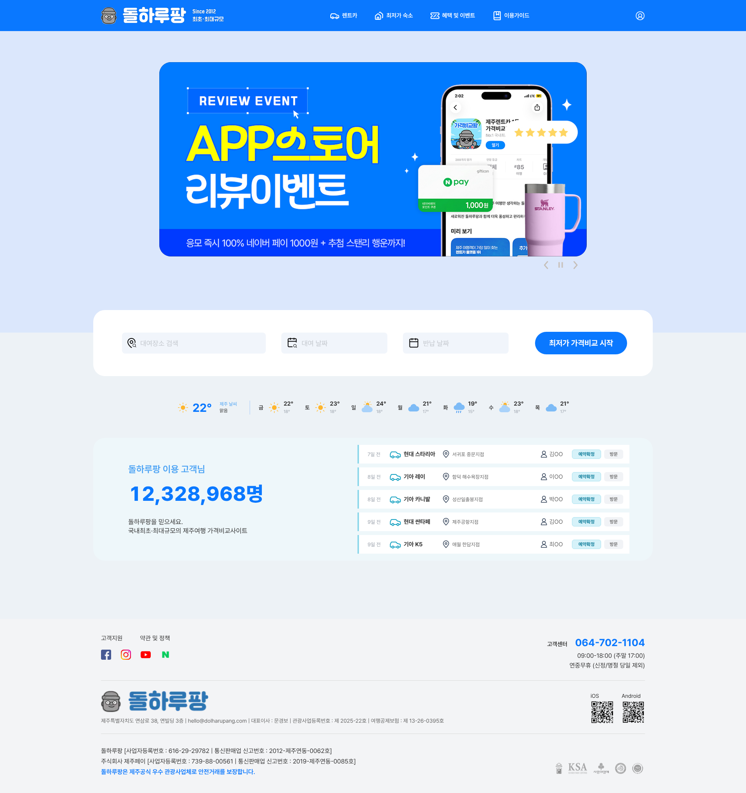
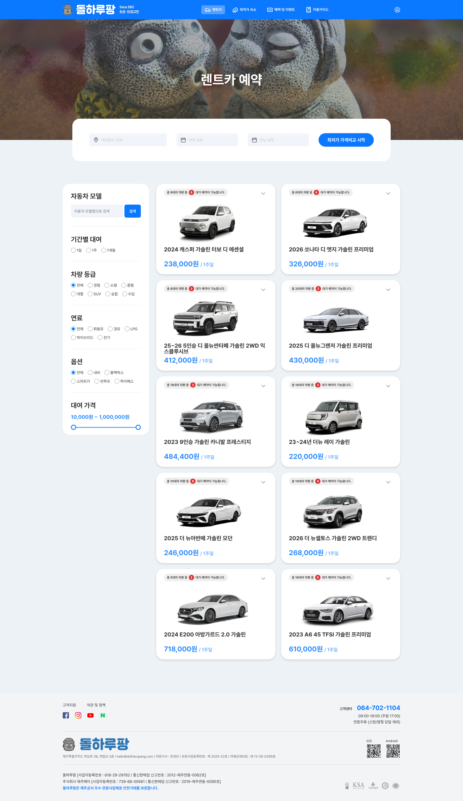
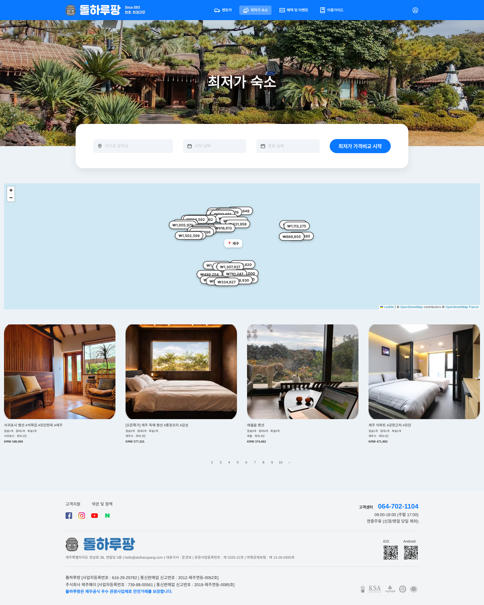
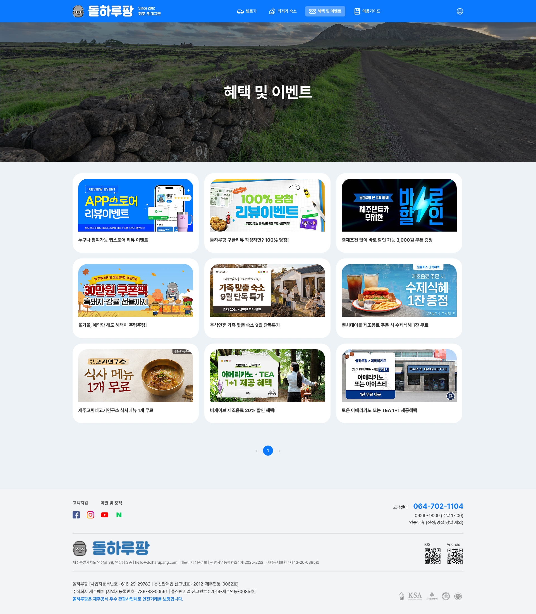
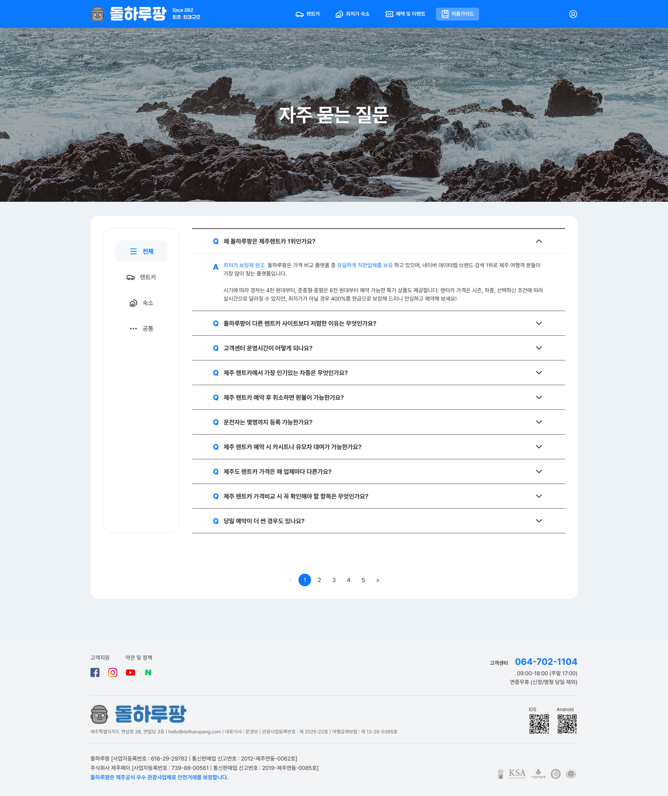
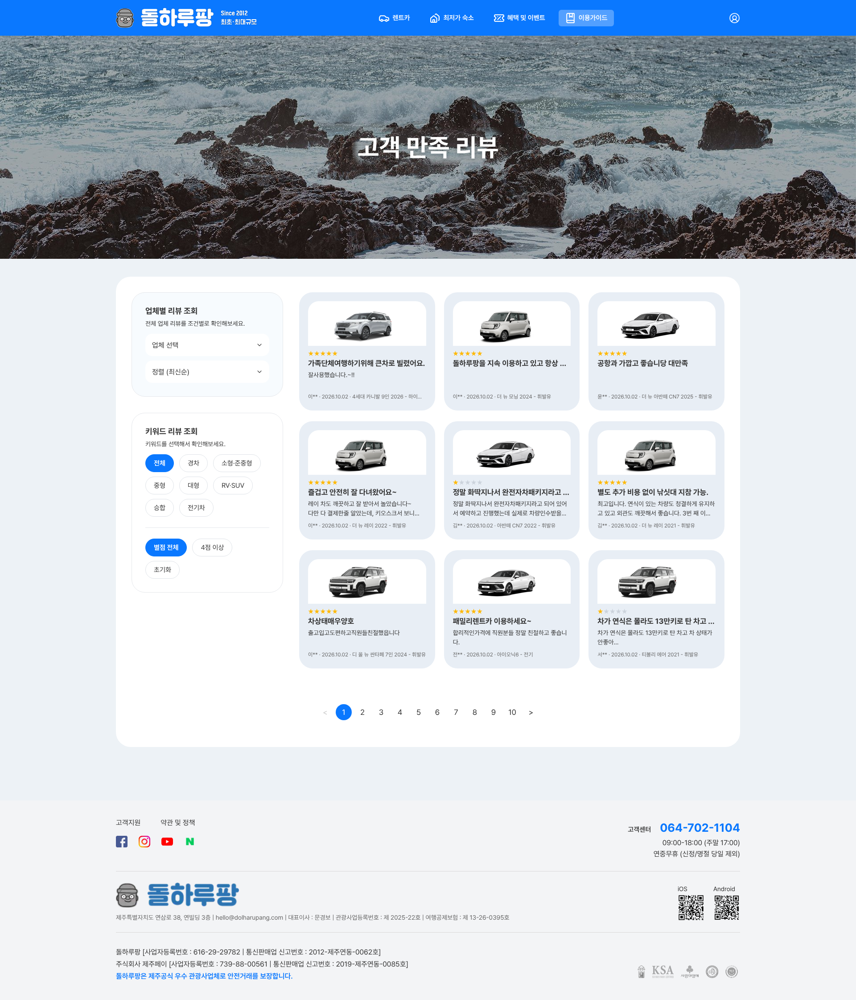

<p align="center">
  
</p>

# 돌하루팡 리뉴얼 (TEAM 카링)

> **여행의 첫 단계, 렌트카 예약을 더 넓고 단순하게**
> 제주 렌트카 가격비교 서비스 돌하루팡의 화면 구조와 정보 위계를 다시 설계한 UX/UI 리뉴얼 프로젝트

링크

- 배포 사이트 : [돌하루팡 리뉴얼 바로가기](https://114soyeon.github.io/caring)
- GitHub : [저장소](https://github.com/114soyeon/caring)
- 원본 사이트 : [돌하루팡 렌트카](https://www.dolharupang.com/cars)

<br>

## 기획 의도

**불편한 점**

- 콘텐츠가 화면 가운데 절반 정도에만 몰려 있어, 큰 화면에서 정보가 작게 보인다.
- 헤더에 배너, SNS, 아이콘, 로고, 8개 메뉴가 겹쳐 있어 시선이 흩어진다.
- 검색, 예약 현황, 안내, 후기가 비슷한 무게로 나열되어 무엇부터 봐야 할지 모른다.
- 어떤 버튼을 눌러도 상단 이미지가 그대로라 페이지가 바뀐 느낌이 없다.

**해결 방법**

- 화면 폭을 넓게 쓰고, 목록은 카드형 그리드로 한눈에 비교할 수 있게 한다.
- 헤더는 로고와 핵심 메뉴 4개(렌트카, 최저가 숙소, 혜택 및 이벤트, 이용가이드)로 줄인다.
- 페이지마다 다른 제주 사진과 제목을 두어 지금 어디에 있는지 알 수 있게 한다.
- 장소·날짜는 한 줄 검색바에서 바로 고르고, 이용 고객 수·실시간 예약·제주 날씨는 한 영역에 모은다.

<br>

## 프로젝트 정보

| 구분      | 내용                                        |
| --------- | ------------------------------------------- |
| 기간      | 2026.10.01 ~ 2026.10.06 (약 1주)            |
| 팀 구성   | 4명 (UI/UX 디자인, 맡은 화면 직접 퍼블리싱) |
| 디자인 툴 | Figma                                       |
| 협업 툴   | Figma, GitHub                               |

**기술 스택**

| 구분       | 사용 기술             |
| ---------- | --------------------- |
| 프론트엔드 | HTML, CSS, JavaScript |
| 배포       | GitHub Pages          |

<br>

## 주요 화면 & 기능

### 1. 메인



> 나혜진 : 메인 페이지 디자인, 퍼블리싱

- 메인 슬라이더 : 3초마다 자동 전환, 이전·일시정지·다음 버튼
- 대여 조건 검색 : 장소·대여일·반납일을 한 줄에서 입력, 빈 칸이 있으면 알려줌
- 제주 날씨 : 오늘부터 7일치 요일과 최고·최저 기온
- 누적 이용 고객 : 화면에 보이면 숫자가 올라가는 카운트업
- 실시간 예약 : 예약 목록이 한 줄씩 위로 굴러감

### 2. 렌트카



> 권지원 : 렌트카 페이지 디자인, 퍼블리싱

- 필터 : 모델명, 대여 기간, 차량 등급, 연료, 옵션, 대여 가격
- 기간별 가격 : 1일·1주·1개월에 맞춰 가격 자동 계산
- 차량 카드 : 화살표를 누르면 시작·종료 시간과 대여 기간이 펼쳐지고, 시간을 직접 바꿀 수 있음

### 3. 최저가 숙소



> 김미래 : 최저가 숙소 페이지 디자인, 퍼블리싱

- 숙소 검색 : 숙소명·지역과 날짜로 검색, 가격 낮은 순 정렬
- 지도 : 숙소마다 가격 표시, 누르면 해당 숙소 카드로 이동
- 카드와 지도 연동 : 카드에 마우스를 올리면 지도의 가격 표시가 강조됨

### 4. 혜택 및 이벤트



> 김소연 : 혜택 및 이벤트 페이지 디자인, 퍼블리싱

- 이벤트 목록 : 진행 중인 이벤트를 썸네일과 제목으로 표시

### 5. 이용가이드

<p>
  
  
</p>

> 김소연 : 자주 묻는 질문, 고객 만족 리뷰 디자인, 퍼블리싱

- 자주 묻는 질문 : 카테고리 탭(전체·렌터카·숙소·공통), 누른 질문만 펼쳐지는 목록
- 고객 만족 리뷰 : 업체, 정렬, 차종, 별점, 사진 리뷰로 골라 보기

### 공통 (헤더 · 푸터)

> 김소연 : 헤더, 푸터 디자인, 퍼블리싱

- 헤더 : 로고 + 핵심 메뉴 4개, 이용가이드에 마우스를 올리면 하위 메뉴
- 맨 위로 버튼, 상담톡 버튼

<br>

## 팀원별 역할

**UI/UX 디자인 · 퍼블리싱**

- **권지원** ([@alice207116116-debug](https://github.com/alice207116116-debug)) : 렌트카, 회의 진행
- **김미래** ([@mimimiqqq](https://github.com/mimimiqqq)) : 최저가 숙소, 전반적인 Figma 디자인 피드백
- **김소연** ([@114soyeon](https://github.com/114soyeon)) : 헤더·푸터, 혜택 및 이벤트, 이용가이드, Git 관리
- **나혜진** ([@nahj272](https://github.com/nahj272)) : 메인 페이지, README·PPT 작성

<br>

## 협업 방식

- 화면별로 담당을 나누고, 디자이너도 맡은 화면을 직접 퍼블리싱
- 디자인은 Figma 파일 하나에서 함께 작업
- 김미래가 전체 디자인을 보고 피드백
- 헤더·푸터는 한 사람이 만들고 모든 페이지에서 같이 사용
- Git은 김소연이 맡아 하나로 모은 뒤 배포

<br>

## 트러블 슈팅

### 권지원 (alice207116116-debug)

**어려웠던 점**

- 차량 카드의 화살표를 눌러 상세를 펼치면, 같은 줄에 있는 옆 카드까지 함께 길어져서 둘 다 열린 것처럼 보였다.

**해결 방법**

- 그리드는 기본으로 같은 줄의 칸을 가장 긴 칸 높이에 맞춰 늘린다. 정렬을 위쪽 기준(`align-items: start`)으로 바꿔 카드가 각자 자기 높이만큼만 차지하게 했다.

**배운 점**

- 화면이 이상하게 움직일 때 원인이 기능이 아니라 레이아웃의 기본값일 수 있다는 걸 알게 됐다.

### 김미래 (mimimiqqq)

**어려웠던 점**

- 숙소 사진의 모서리가 둥글지 않고 각져 보였다.

**해결 방법**

- `border-radius: var(--radius)`로 지정했는데, `--radius` 변수가 어디에도 정의되어 있지 않았다. 변수에 기대지 않고 24px로 직접 지정했다.

**배운 점**

- 정의되지 않은 변수는 오류 없이 무시돼서 원인을 찾기 어렵다. 변수를 쓸 때는 실제로 정의되어 있는지 먼저 확인해야 한다.

### 김소연 (114soyeon)

**어려웠던 점**

- 헤더와 푸터를 공통으로 작업했는데, 다른 팀원의 페이지에서 깨져 보였다. 공통 작업을 올리는 과정에서 다른 페이지 작업물까지 함께 커밋되어 파일이 꼬인 상태였다.

**해결 방법**

- 각자 담당한 페이지에는 작업한 헤더와 푸터가 살아 있는 것을 확인했다. 메인에 있는 작업물을 브랜치로 받고 다시 올리는 과정을 반복해 모든 페이지의 헤더와 푸터를 바로잡았다.

**배운 점**

- 여러 사람이 같이 쓰는 부분은 작은 실수도 모든 페이지에 퍼진다. 올리기 전에 내 작업만 들어갔는지 확인해야 한다.

### 나혜진 (nahj272)

**어려웠던 점**

- 미리 맞춰 둔 슬라이더 크기와 원본 이미지 비율이 맞지 않아 이미지가 잘리거나 어색하게 보였다.

**해결 방법**

- 슬라이더 크기를 원본 이미지 비율(2200 × 1000)에 맞게 1100 × 500으로 줄이고, 화면이 줄어도 같은 비율을 유지하게 했다.

**어려웠던 점**

- 메인의 제주 날씨가 항상 같은 요일 순서로 고정되어 있어, 언제 접속해도 요일과 기온이 실제 날짜와 맞지 않았다.

**해결 방법**

- 오늘 날짜를 기준으로 7일치 요일을 계산해 그리도록 바꿨다. 무료 날씨 API(Open-Meteo)로 제주 예보를 받아 최고·최저 기온을 채우고, 받아오지 못하면 기본값을 보여주게 했다.

**배운 점**

- 이미지는 크기보다 비율을 먼저 맞춰야 어떤 화면에서도 깨지지 않는다.
- 날짜처럼 바뀌는 정보는 직접 적지 말고 계산하거나 받아와야 한다.

<br>

---

## 부록

### 정보 구조 (IA)

```
메인
├─ 렌트카
├─ 최저가 숙소
├─ 혜택 및 이벤트
└─ 이용가이드 ─┬─ 자주 묻는 질문
               └─ 고객 만족 리뷰
```

### 디자인 규칙

**색의 역할**

| 색        | HEX       | 역할                       |
| --------- | --------- | -------------------------- |
| 파랑      | `#0A78FF` | 헤더, 주요 버튼, 선택 상태 |
| 연한 파랑 | `#E5F2FF` | 선택 배경, 강조 영역       |
| 글자      | `#333333` | 기본 글자                  |
| 보조 글자 | `#666666` | 설명, 날짜                 |
| 배경      | `#EDF2F6` | 페이지 배경                |

**레이아웃**

- 화면 규격: 1920 × 1080
- 콘텐츠 최대 폭: 1440px
- 카드 간격: 24px

**글꼴·아이콘**

- 글꼴: Pretendard

### 폴더 구조

```
caring
├─ index.html   # 메인
├─ cars.html    # 렌트카
├─ stays.html   # 최저가 숙소
├─ event.html   # 혜택 및 이벤트
├─ faq.html     # 자주 묻는 질문
├─ review.html  # 고객 만족 리뷰
├─ css          # 공통 스타일, 화면별 스타일
├─ js           # 공통 기능, 화면별 기능, 차량·질문·리뷰 데이터
├─ images       # 로고, 아이콘, 화면별 이미지
└─ docs         # README 화면 캡처
```

<br>

---

_본 저장소는 학습·기획 목적의 팀 프로젝트이며, 원본 서비스의 화면과 캐릭터 저작권은 각 권리자에게 있습니다._
